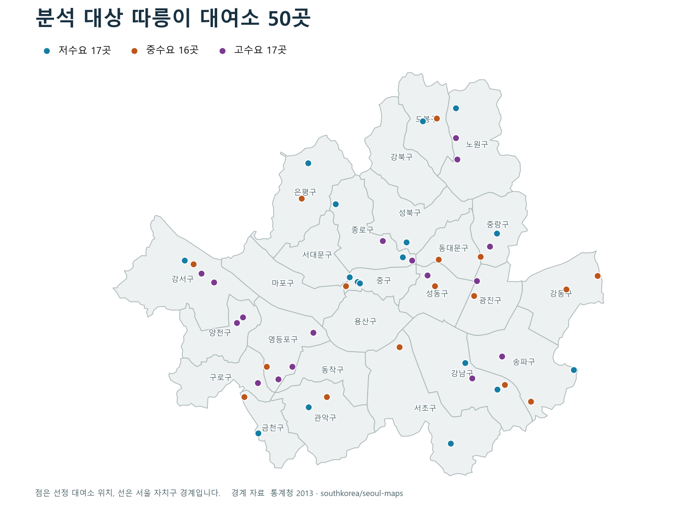

# 서울 따릉이 대여소의 다음 1시간 대여량 예측

2023~2024년 서울 따릉이 기록으로 다음 한 시간의 출발 건수를 예측했다. 안정적으로 운영된 대여소 50곳을 개별 분석하고, 서울 전체 대여소 2,766곳은 인접 대여소를 묶어 분석했다. 군집 분석에서는 기존 500m 구획과 실루엣 점수로 고른 600m 구획을 같은 예측 대상에서 비교했다.

## 실루엣 점수로 고른 855개 군집의 수요 예측

2024년 12월 서울 따릉이 대여소 2,766곳을 대상으로, 한 군집에서 가장 멀리 떨어진 두 대여소의 직선거리를 몇 m까지 허용할지 비교했다. 가장 먼 두 대여소 사이의 거리를 기준으로 가까운 군집부터 합치는 완전연결 계층 군집화를 사용했다. 동일한 군집 트리를 다섯 거리에서 잘랐을 때 **600m에서 평균 실루엣이 0.41767로 가장 높았고, 855개 군집이 생겼다.** 기존 500m와의 점수 차이는 0.00230이다. 같은 855개 지역의 4분기 수요를 예측할 때는 기존 500m 모델의 예측을 합산하는 방법이 8개 조건 중 7개에서 MAE와 RMSE 모두 더 낮았다.

실루엣은 대여소마다 같은 군집 내 다른 대여소까지의 평균 거리와, 평균적으로 가장 가까운 다른 군집까지의 거리를 비교한다. 점수 범위는 −1~1이며 높을수록 자기 군집 안의 대여소가 상대적으로 가깝다. 단독 대여소의 점수는 0으로 두고 전체 2,766곳에 같은 가중치를 줬다. 거리 선택에는 대여 건수나 예측 점수를 사용하지 않았다.

| 군집 내 최대 허용 거리 | 군집 수 | 단독 군집 수 | 평균 실루엣 |
|---:|---:|---:|---:|
| 300m | 1,517 | 654 | 0.37293 |
| 400m | 1,229 | 332 | 0.40366 |
| 500m | 1,021 | 166 | 0.41537 |
| 600m | 855 | 81 | 0.41767 |
| 700m | 743 | 47 | 0.41210 |

지도의 점은 개별 대여소이고 연결선은 같은 군집의 대여소를 표시한다. [855개 군집 지도](%EB%94%B0%EB%A6%89%EC%9D%B4%20%EB%8C%80%EC%97%AC%EC%86%8C%20%EB%B9%84%EA%B5%90/%EC%8B%A4%EB%A3%A8%EC%97%A3%20%EC%84%A0%ED%83%9D%20%EA%B5%B0%EC%A7%91%20%EC%A7%80%EB%8F%84.geojson) · [대여소별 군집 배정](%EB%94%B0%EB%A6%89%EC%9D%B4%20%EB%8C%80%EC%97%AC%EC%86%8C%20%EB%B9%84%EA%B5%90/%EC%8B%A4%EB%A3%A8%EC%97%A3%20%EC%84%A0%ED%83%9D%20%EA%B5%B0%EC%A7%91%20%EB%B0%B0%EC%A0%95.csv) · [거리별 점수](%EB%94%B0%EB%A6%89%EC%9D%B4%20%EB%8C%80%EC%97%AC%EC%86%8C%20%EB%B9%84%EA%B5%90/%EA%B5%B0%EC%A7%91%20%EA%B1%B0%EB%A6%AC%EB%B3%84%20%EC%8B%A4%EB%A3%A8%EC%97%A3.csv) · [군집별 연간 수요와 피크 시간](%EB%AA%A8%EB%8D%B8/%EC%8B%A4%EB%A3%A8%EC%97%A3%20%EA%B5%B0%EC%A7%91%EB%B3%84%20%EB%8C%80%EC%97%AC%20%EC%88%98%EC%9A%94.csv)

### 855개 군집의 분기별 검증

2023년부터 각 평가 분기 직전까지의 자료로 학습해 2024년 각 분기의 다음 한 시간 출발 건수를 예측했다. 이용시간과 거리가 모두 양수인 출발은 2023년 42,810,716건, 2024년 42,219,615건이다. 기본 입력에는 최근 출발량, 전주 동일 시간 출발량, 달력, 직전 기상이 들어간다. 반납량 추가 조건은 직전 1시간과 3시간의 도착 건수를, 유사 기상 추가 조건은 과거 같은 시각·요일 유형에 기상이 비슷했던 최대 5개 시점의 평균 출발 건수와 사례 유무를 사용한다. 모든 조건에서 MSE 손실, 시드 42, 4에포크를 사용했다.

| 모델 | 기본 입력에 추가한 피처 | 1~3분기 평균 MAE | 1~3분기 평균 RMSE | 4분기 MAE | 4분기 RMSE |
|---|---|---:|---:|---:|---:|
| MLP | 없음 | 2.1331 | 3.6779 | 1.9254 | 3.3084 |
| MLP | 반납량만 | 2.1115 | 3.6615 | 1.9316 | 3.3527 |
| MLP | 유사 기상만 | 2.0824 | 3.5643 | 1.8733 | 3.2728 |
| MLP | 둘 다 | 2.2982 | 3.8154 | 1.8891 | 3.3375 |
| GRU | 없음 | 2.1389 | 3.6947 | 1.9397 | 3.3073 |
| GRU | 반납량만 | 2.0686 | 3.5562 | 1.8994 | 3.2430 |
| GRU | 유사 기상만 | 2.0701 | 3.5219 | 1.8881 | 3.2102 |
| GRU | 둘 다 | 2.0130 | 3.4113 | 1.8743 | 3.1785 |

오차 단위는 군집 한 곳의 한 시간당 대여 건수다. 1~3분기는 분기별 점수의 단순평균이고, 4분기는 92일 × 24시간 × 855곳의 1,887,840개 관측값 전체를 평가했다. 4분기 최저 MAE는 MLP(추가 피처 ‘유사 기상만’)의 1.8733건으로, 전주 동일 시간 기준선 2.8533건보다 34.3% 낮았다. [32개 분기별 모델 결과](%EB%AA%A8%EB%8D%B8/%EC%8B%A4%EB%A3%A8%EC%97%A3%20%EA%B5%B0%EC%A7%91%20%ED%94%BC%EC%B2%98%EB%B3%84%20%EC%84%B1%EB%8A%A5.csv) · [전날·전주 기준선](%EB%AA%A8%EB%8D%B8/%EC%8B%A4%EB%A3%A8%EC%97%A3%20%EA%B5%B0%EC%A7%91%20%EA%B8%B0%EC%A4%80%EC%84%A0%20%EC%84%B1%EB%8A%A5.csv)

855개 군집에서 직접 학습한 모델 중 MAE가 가장 낮은 조합은 유사 기상만 추가한 MLP(1.8733)였다. RMSE는 반납량과 유사 기상을 함께 추가한 GRU(3.1785)가 가장 낮았다.

### 같은 855개 군집에서 기존 500m와 비교

기존 500m 모델 8개의 4분기 예측을 복원해 기존 점수와 일치하는지 확인했다. 이후 같은 시간에 나온 500m 예측을 855개 상위 군집별로 더했다. 아래 두 열은 모두 **동일한 855개 군집과 동일한 실제 대여 건수**를 기준으로 계산한 4분기 MAE다. 두 방식 중 오차가 작은 값을 굵게 표시했다.

| 모델 | 추가 피처 | 500m 예측 합산 MAE | 600m 직접 예측 MAE |
|---|---|---:|---:|
| MLP | 없음 | 1.9843 | **1.9254** |
| MLP | 반납량만 | **1.9155** | 1.9316 |
| MLP | 유사 기상만 | **1.8639** | 1.8733 |
| MLP | 둘 다 | **1.8307** | 1.8891 |
| GRU | 없음 | **1.9203** | 1.9397 |
| GRU | 반납량만 | **1.8521** | 1.8994 |
| GRU | 유사 기상만 | **1.8782** | 1.8881 |
| GRU | 둘 다 | **1.8343** | 1.8743 |

8개 모델·피처 조합 중 600m 직접 학습의 MAE가 더 낮은 조합은 1개였다. 실루엣은 공간적 응집도를 평가하고, 예측 오차는 학습한 수요 패턴까지 반영한다. 이번 비교는 2024년 12월 대여소 구성을 과거 기간에 고정하고, 이전 실험에서도 살펴본 4분기를 한 시드로 평가한 회고 분석이다. [같은 군집에서의 MAE·RMSE 전체 비교](%EB%AA%A8%EB%8D%B8/%EB%8F%99%EC%9D%BC%20855%EA%B0%9C%20%EA%B5%B0%EC%A7%91%204%EB%B6%84%EA%B8%B0%20%EC%84%B1%EB%8A%A5%20%EB%B9%84%EA%B5%90.csv)

**Jupyter 실행 순서**

1. [실루엣 선택·수요 집계·기준선·MLP·GRU 학습](%EB%AA%A8%EB%8D%B8/%EB%94%B0%EB%A6%89%EC%9D%B4_%EC%8B%A4%EB%A3%A8%EC%97%A3_%EA%B5%B0%EC%A7%91_%EC%88%98%EC%9A%94%EC%98%88%EC%B8%A1.ipynb)에서 아래 1,021개 군집 실험과 동일한 2023·2024년 전처리 ZIP 두 개를 준비한 뒤 셀을 순서대로 실행한다.
2. [동일한 855개 군집에서 4분기 예측 비교](%EB%AA%A8%EB%8D%B8/%EB%94%B0%EB%A6%89%EC%9D%B4_%EB%8F%99%EC%9D%BC%EA%B3%B5%EA%B0%84_4%EB%B6%84%EA%B8%B0_%EB%B9%84%EA%B5%90.ipynb)를 실행한다. 두 노트북에는 실행 결과가 저장되어 있고, 두 구획의 4분기 가중치 16개도 모델 폴더에 포함했다.

## 1,021개 군집의 반납량·유사 기상 비교

2024년 12월 서울 대여소 2,766곳을 군집 내 모든 대여소 쌍의 직선거리가 500m 이하가 되도록 묶었다. 각 군집에서 다음 한 시간 동안 출발할 유효 대여 건수를 예측했다. **4분기에는 MLP와 GRU 모두 반납량과 유사 기상을 함께 넣었을 때 MAE와 RMSE가 가장 낮았다.**

기본 입력은 군집번호, 직전 24시간과 전주 동일 시간의 출발량, 달력, 직전 시각의 기온·습도·강수량·풍속이다. 여기에 다음 두 입력을 각각 또는 함께 추가했다.

- **반납량**은 예측 정시 직전 1시간과 3시간 동안 해당 군집에 실제로 반납된 건수다.
- **유사 기상**은 지난 365일 중 같은 시각·요일 유형·강수 유무에서 직전 날씨가 비슷했던 최대 5개 시점의 **해당 군집 평균 출발량**이다. 매칭 사례의 유무도 함께 입력했다.

| 모델 | 기본 입력에 추가한 피처 | 1~3분기 평균 MAE | 1~3분기 평균 RMSE | 4분기 MAE | 4분기 RMSE |
|---|---|---:|---:|---:|---:|
| MLP | 없음 | 1.9186 | 3.3142 | 1.7806 | 3.0744 |
| MLP | 반납량만 | **1.8507** | 3.1786 | 1.7208 | 2.9679 |
| MLP | 유사 기상만 | 1.8787 | 3.1967 | 1.6775 | 2.8921 |
| MLP | 둘 다 | 1.8523 | **3.1483** | **1.6472** | **2.8315** |
| GRU | 없음 | 1.9077 | 3.2831 | 1.7265 | 2.9410 |
| GRU | 반납량만 | 1.8447 | 3.1661 | 1.6653 | 2.8618 |
| GRU | 유사 기상만 | 1.8638 | 3.1492 | 1.6899 | 2.8961 |
| GRU | 둘 다 | **1.8075** | **3.0640** | **1.6494** | **2.8480** |

피처를 하나만 추가할 때 1~3분기 평균 MAE는 두 모델 모두 반납량을 넣은 쪽이 낮았다. MLP에서는 반납량만 넣었을 때 MAE가 두 피처를 함께 넣었을 때보다 0.0016건 낮아 차이가 작았다. 4분기에는 단독 추가 결과가 모델에 따라 달랐다. MLP는 유사 기상만 넣었을 때, GRU는 반납량만 넣었을 때 MAE가 더 낮았다.

오차 단위는 **군집 한 곳의 한 시간당 대여 건수**다. 각 분기 직전까지의 자료로 학습했으며 네 조건에서 MSE 손실, 4에포크, 시드 42를 공통으로 사용했다. 1~3분기 수치는 분기별 점수의 단순평균이다. 12월 군집 구성을 과거에도 고정했고 4분기는 이전 실험에서도 평가한 기간이므로 회고 비교로 해석한다. [분기별 전체 결과 CSV · 4개 분기 × 2개 모델 × 4개 입력 조건](모델/1021개%20군집%20피처%20개별%20비교.csv)

### 1,021개 군집 실험 노트북

| 실행 순서 | 주피터 노트북 | 확인할 내용 |
|---:|---|---|
| 1 | [군집별 수요와 기본 MLP·GRU](모델/따릉이_1021개_군집_수요분석.ipynb) | 군집별 시간대 패턴, 전날·전주 기준선, 기본 모델 성능 |
| 2 | [반납량과 유사 기상을 함께 추가](모델/따릉이_1021개_군집_MLP_GRU_반납_유사기상.ipynb) | 두 피처의 생성 과정과 기본 모델 대비 분기별 오차 변화 |
| 3 | [반납량만·유사 기상만 추가하고 네 조건 비교](모델/따릉이_1021개_군집_MLP_GRU_피처_개별비교.ipynb) | 각 피처를 따로 넣은 MLP·GRU의 학습 코드와 네 조건의 MAE·RMSE 표 |

세 노트북에는 실행 결과가 저장돼 있다. 네 조건의 비교표는 3번 노트북 마지막 셀에서 볼 수 있다. 전체 실험을 재학습하려면 [서울시 공공자전거 대여이력](https://data.seoul.go.kr/dataList/OA-15182/F/1/datasetView.do)의 2023·2024년 자료에서 이용시간과 이동거리가 모두 양수인 기록만 남긴 연도별 ZIP 두 개를 `분석용 데이터/`에 준비한다. 각 ZIP에는 대여 시작월 기준 월별 CSV 12개(CP949, 파일명 끝 `YYYY-MM.csv`)가 들어가며, ZIP 파일명은 `대여이력`으로 시작한다. 위 순서대로 각 노트북의 셀을 실행하면 출발·반납 집계와 모델 비교 결과가 생성된다. 세부 집계는 [출발 집계 코드](전처리/rental_aggregate.py)와 [군집별 반납 집계 코드](전처리/cluster_returns.py)에서 확인할 수 있다.

## 대여소 위치 지도

### 고·중·저수요 분류 기준

**2023년 1월부터 2024년 6월까지 각 대여소에서 출발한 유효 대여 건수**로 등급을 정했다. 이용시간과 이동거리가 모두 양수인 대여만 세었다. 운영 안정성 기준을 충족한 후보 2,206곳을 건수가 적은 순으로 정렬하고, 건수가 같으면 대여소 번호가 작은 곳을 먼저 두었다. 이 순위를 세 그룹으로 나눈 뒤 각 그룹에서 지도에 표시할 대여소를 뽑았다.

| 지도 색 | 수요 등급 | 후보 2,206곳에서의 위치 | 지도에 표시한 대여소 |
|---|---|---|---:|
| 파란색 | 저수요 | 대여 건수가 가장 적은 736곳 | 17곳 |
| 주황색 | 중수요 | 그다음 735곳 | 16곳 |
| 보라색 | 고수요 | 대여 건수가 가장 많은 735곳 | 17곳 |

[확대해서 보는 대여소 지도](분석용%20데이터/대여소_위치.geojson)에서 마커를 선택하면 대여소 번호·이름·자치구·수요 등급을 볼 수 있다. 별표는 [시간별 데이터 샘플](분석용%20데이터/대여소_시간별_샘플.csv)에 포함된 여의도초교 앞(221번), 대림3동사거리(289번), SK 남산빌딩(435번)이다.

## 최근 반납량이 예측에 도움이 될까?

기존 모델은 대여소, 과거 대여량, 달력, 직전 기상 관측값, 날씨가 비슷했던 과거의 평균 대여량을 사용한다. 여기에 예측 시각 직전 **1시간과 3시간 동안 해당 대여소에 반납된 건수**를 추가했다. 예를 들어 오전 9시 예측에는 9시 정각 전에 확인된 반납만 포함했다. 분석 기간 중 50곳으로 들어온 유효 반납 1,660,112건의 약 91%가 표본 밖에서 출발해, 반납 집계에는 서울 전체 출발지를 포함했다.

| 모델 | 입력 | 1~3분기 평균 MAE | 1~3분기 평균 RMSE | 4분기 MAE | 4분기 RMSE |
|---|---|---:|---:|---:|---:|
| MLP | 기존 | 1.0710 | 1.7016 | 0.9819 | 1.5567 |
| MLP | 기존 + 반납량 | 1.0524 | 1.6727 | 0.9491 | 1.5246 |
| GRU | 기존 | 1.0780 | 1.7137 | 0.9691 | 1.5538 |
| GRU | 기존 + 반납량 | 1.0587 | 1.6797 | 0.9501 | 1.5297 |

단위는 대여소 한 곳의 한 시간당 대여 건수다. 반납량을 추가하자 세 분기 평균 MAE가 MLP에서 1.74%, GRU에서 1.79% 줄었다. 두 모델 모두 1분기에는 약 0.010건 줄었고, 3분기에는 각각 0.026건과 0.024건 줄었다. 반납량은 최근 자전거 유입과 주변 이동량을 함께 반영할 수 있다. 실제 가용 자전거 수나 운영자의 재배치 기록을 사용하지 않아 두 효과를 따로 추정하기는 어렵다.

## 평가 방법과 해석 범위

- 2024년 1~3월, 4~6월, 7~9월을 각각 검증했다. 각 fold에서는 2023년 1월부터 해당 분기 직전까지 학습했다. 표의 교차검증 수치는 세 분기의 단순평균이다.
- 반납량 추가 전후에 학습 손실(MSE), 모델 구조, 학습 횟수와 시드를 고정했다. 10~12월의 110,400개 대여소·시간도 비교했으며, 이 기간은 앞선 실험에서 이미 평가한 구간이다.
- 대여 건수는 이용시간과 이동거리가 모두 양수인 출발 기록을 기준으로 한다. 기존 50곳 선정에 2024년 6월까지의 운영 정보가 반영돼, 초기 두 분기 결과는 선정된 대여소에 대한 회고 평가다.

## 분석 파일

- [실행 결과가 담긴 MLP·GRU 노트북](모델/따릉이_3fold_반납량_추가.ipynb)
- [월별 대여이력에서 반납 입력을 만드는 코드](전처리/return_features.py)
- [분기별 MAE·RMSE와 추가 전후 차이](모델/3fold%20반납%20추가%20성능.csv)

[분석용 데이터 폴더](분석용%20데이터/)에 50개 대여소 모델의 시간별 대여량·기상표, 직전 반납량, 서울 전체 이용량·기상 CSV가 들어 있다. 이 **50개 대여소 노트북**은 연도별 대여이력 ZIP 없이 실행할 수 있다. Python 3.11에서 pandas, NumPy, PyArrow, PyTorch, Matplotlib, Jupyter를 사용했다. [파일별 설명과 원본 출처](분석용%20데이터/README.md)

대여이력과 대여소 정보는 서울 열린데이터광장, 시간별 기상은 서울 자전거 공유 데이터셋을 사용했다. [서울시 공공자전거 대여이력](https://data.seoul.go.kr/dataList/OA-15182/F/1/datasetView.do) · [기상 데이터](https://www.kaggle.com/datasets/lnoahl/seoul-bike-sharing-dataset)
